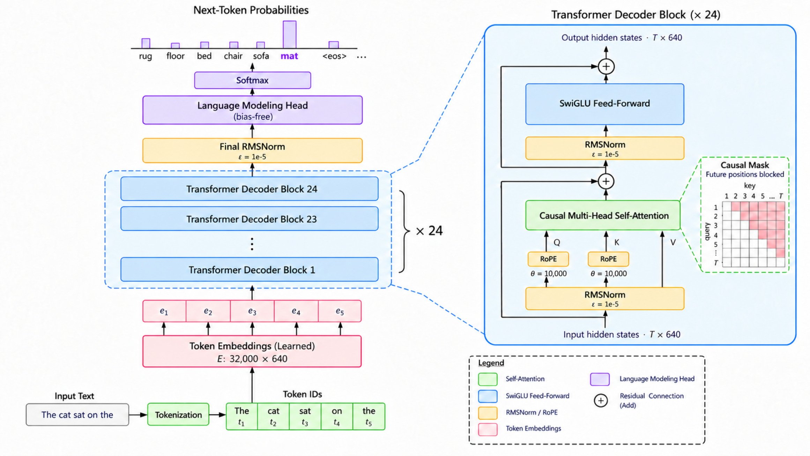
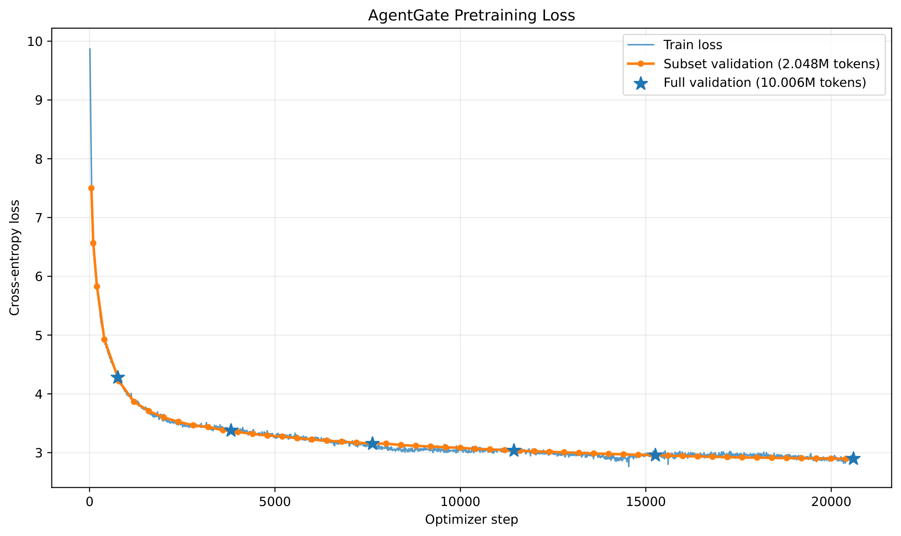
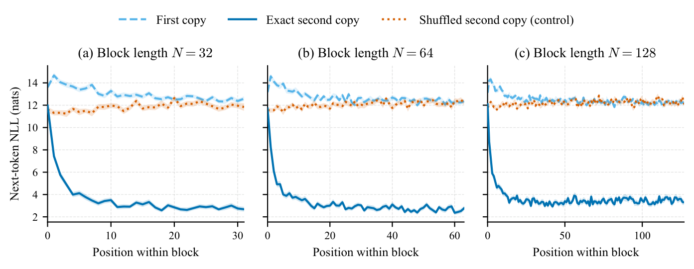
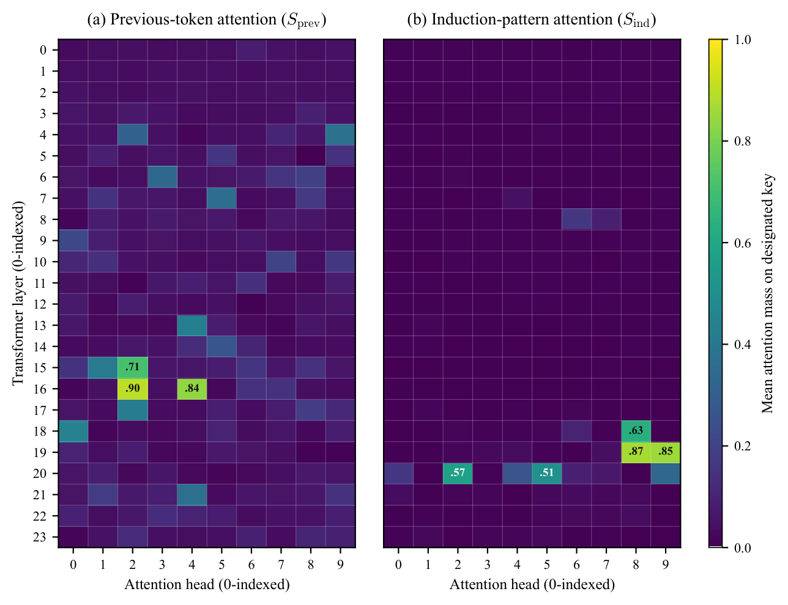
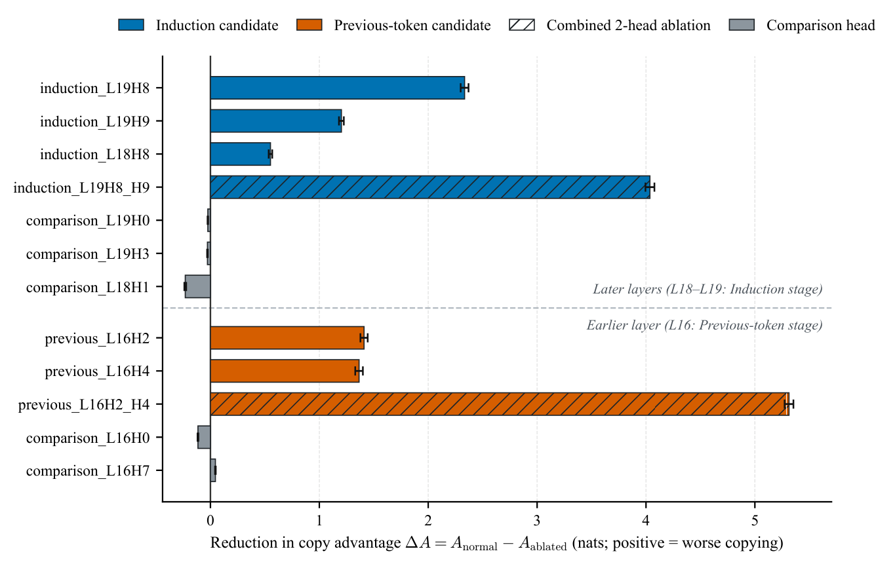
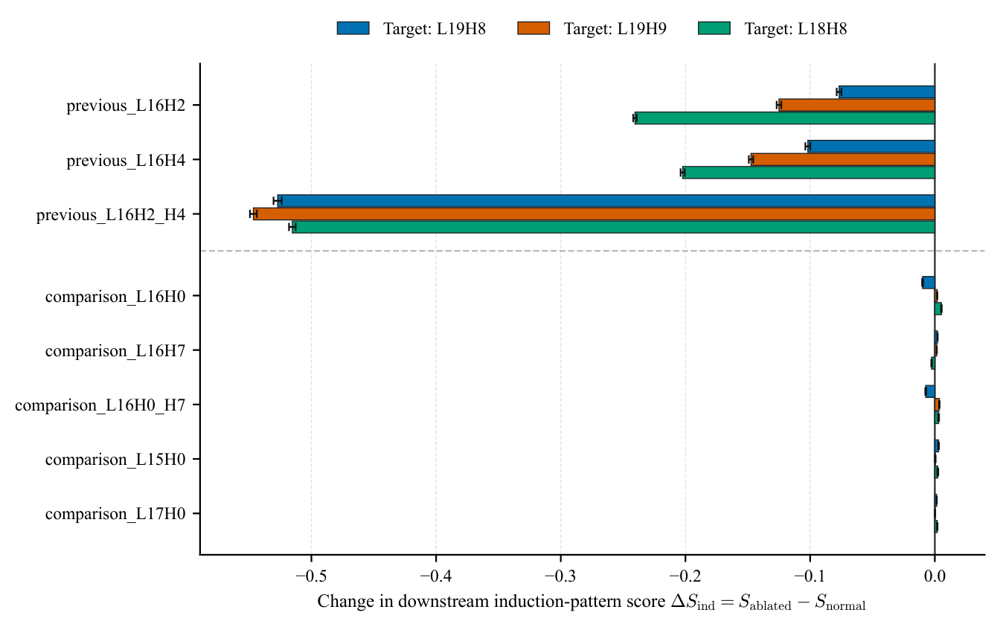

# AgentGate: Pretraining and Benchmarking a Small Language Model with an Investigation of Its Induction Circuits

**AgentGate-Base-142M** is a 142.4M-parameter decoder-only Transformer **pretrained from scratch** on approximately **2.7 billion tokens**, then evaluated on standard language-model benchmarks and studied using mechanistic interpretability techniques.

## Overview

Interest in **small language models (SLMs)** has grown because of their potential to reduce memory requirements and inference costs. Smaller models may be useful as components in AI agents, edge applications, and resource-constrained systems such as cyber-physical systems.

Motivated by this direction, we built **AgentGate**, a 142.4-million-parameter language model trained entirely from scratch on a mixture of **FineWeb-Edu-Dedup (80%)** and **Cosmopedia-v2 (20%)**. Our goal was not only to develop a working pretrained model, but to explore what could be achieved with a *very limited compute budget*.

We trained on an **NVIDIA L4 GPU through Modal**, targeting its **$30 monthly compute credit**. The final training run consumed approximately **36 GPU-hours** and cost **$28.79 in GPU usage**; total experimental expenditure was approximately **$34**, including CPU charges, smoke tests, and checkpoint restarts.

We went beyond training: we benchmarked AgentGate against **GPT-2 Small, Pythia-160M, and SmolLM-135M** on ARC-Easy, HellaSwag, and PIQA. We then investigated **induction-like circuits** through controlled sequence-repetition tests, attention-head specialization analysis, causal head ablations, and experiments on cross-layer functional dependencies.

**The goal of this project is to document the full process of building, evaluating, and probing the internal behavior of a small language model under a constrained budget.**

## At a glance

| Item | AgentGate-Base-142M |
|---|---|
| Architecture | Decoder-only Transformer |
| Parameters | **142,408,320** (142.4M) |
| Pretraining tokens | **~2.7B** |
| Training data | FineWeb-Edu-Dedup (80%) + Cosmopedia-v2 (20%), by token count |
| Tokenizer | Custom byte-level BPE, 32,000 vocabulary |
| Layers / hidden size | 24 / 640 |
| Attention | 10-head MHA; head dimension 64 |
| Context length | 2,048 tokens |
| Transformer components | RoPE, Pre-RMSNorm, SwiGLU, tied token embedding/output weights |
| Training hardware | NVIDIA L4 (Modal) |
| Final full-validation loss / perplexity | **2.8964 / 18.11** |
| Main-run GPU cost | **$28.79** (~36 GPU-hours) |
| Total experimental expenditure | **~$34** |

## Model architecture

AgentGate uses a standard causal language-modeling objective, with modern Transformer components: **rotary positional embeddings (RoPE)**, **pre-RMSNorm**, and a **SwiGLU** feed-forward network. It uses conventional multi-head attention (MHA).



The implementation is in [`src/model/agent_gate.py`](src/model/agent_gate.py), with tokenization and dataset preparation in [`src/data/`](src/data/) and training logic in [`src/training/`](src/training/).

## Pretraining results

The model completed **20,599 optimizer steps**, processing approximately **2.70B tokens**. Training remained stable, and the final checkpoint achieved a full-validation loss of **2.8964** (perplexity **18.11**). Average training throughput was approximately **22.75K tokens/s**, with measured Model FLOPs Utilization (MFU) around **23.2%** on the NVIDIA L4.



Additional training plots and derived measurements are in [`training_analysis/`](training_analysis/).

## Zero-shot benchmark results

We used **EleutherAI LM Evaluation Harness v0.4.13**, without task-specific fine-tuning or in-context demonstrations (**0-shot**). All reported figures come from full evaluation splits. Scores below are percentages; **higher is better**.

| Model | Params | ARC-Easy Acc | ARC-Easy Acc\_norm | HellaSwag Acc | HellaSwag Acc\_norm | PIQA Acc | PIQA Acc\_norm |
|---|---:|---:|---:|---:|---:|---:|---:|
| GPT-2 Small | 124M | 43.81 | 39.48 | 28.92 | 31.14 | 62.89 | 62.51 |
| Pythia-160M | 160M | 43.64 | 39.65 | 28.37 | 30.27 | 62.30 | 61.92 |
| **AgentGate (ours)** | **142.4M** | **50.46** | **45.41** | **29.14** | **32.03** | **62.95** | **62.40** |
| SmolLM-135M | 135M | **61.62** | **56.48** | **35.18** | **42.60** | **68.61** | **68.12** |

*Acc* is accuracy based on total continuation log-likelihood. *Acc_norm* uses the harness task's length-normalized scoring convention (character-length normalization for these tasks). Bold on AgentGate identifies our model; SmolLM leads every metric column.

AgentGate scores higher than **Pythia-160M** on all three length-normalized metrics and higher than **GPT-2 Small** on ARC-Easy and HellaSwag. The largest normalized improvements over these two models are on ARC-Easy (**+5.76** and **+5.93 percentage points**, respectively). Differences on PIQA are small. **SmolLM-135M outperforms AgentGate on every benchmark.**

These comparisons are **descriptive, not controlled**: the models differ in training-token budgets, data, tokenizers, and optimization. A model's benchmark score alone cannot establish architectural or compute efficiency.

Full scores and, for the Hugging Face baselines, sample-level outputs are stored in [`benchmark_results/`](benchmark_results/).

### Running benchmarks

Once you have installed the project's dependencies and obtained the AgentGate checkpoint and tokenizer, run from the repository root:

```bash
python -m scripts.eval.run_benchmarks --tasks hellaswag,piqa,arc_easy --limit 0
```

The custom harness adapter is in [`scripts/eval/agentgate_adapter.py`](scripts/eval/agentgate_adapter.py). It uses `checkpoints/final.pt` and `artifacts/tokenizer/bpe_32000.json` by default. **Model checkpoint files are excluded from Git**.

The comparison models can be evaluated with LM Evaluation Harness's `hf` backend, for example:

```bash
lm_eval --model hf \
  --model_args "pretrained=EleutherAI/pythia-160m,dtype=float32" \
  --tasks hellaswag,piqa,arc_easy \
  --num_fewshot 0 --device cuda:0 --batch_size 4 \
  --output_path benchmark_results/pythia_160m
```

## Mechanistic interpretability: investigating induction-like circuits

We asked whether AgentGate learns to use **earlier occurrences of a sequence** to predict its later continuation, and which attention heads contribute to that ability.

**Experiment 1 — Repetition behavior.** We compared first occurrences of random token blocks, exact second copies, and shuffled second copies across block lengths 32, 64, and 128. Exact repetition sharply reduced next-token negative log-likelihood; shuffled copies did not show the same improvement.



**Experiment 2 — Head specialization.** We measured previous-token and induction-pattern attention scores across all **240 attention heads**. Several heads in **layer 16** exhibited strong previous-token patterns; heads in **layers 18–19** showed strong induction-like patterns.



**Experiment 3 — Causal ablation.** Zeroing the outputs of selected heads during inference reduced the model's advantage on repeated sequences. Ablating the pair of previous-token candidates **L16H2 + L16H4** reduced the copy advantage by approximately **5.31 nats**; comparison-head interventions had substantially smaller effects.



**Experiment 4 — Cross-layer dependency.** Simultaneously ablating **L16H2 + L16H4** reduced the induction-pattern attention score of **L19H8 from 0.903 to 0.376**, while selected comparison-head ablations had little effect. This supports a functional dependency between earlier previous-token computations and later induction-pattern attention.



Together, these experiments provide **evidence consistent with an induction-like copying circuit**, not a complete reconstruction of all its internal information pathways. The analysis uses synthetic repetition tasks; it does not establish how often these mechanisms are used in ordinary downstream tasks.

Experiment scripts and machine-readable results are in [`scripts/interpretability/`](scripts/interpretability/) and [`interpretability_results/`](interpretability_results/).

## Repository structure

```text
AgentGate/
├── src/
│   ├── data/                 # Tokenizer, corpus preparation, data loading
│   ├── model/                # AgentGate architecture
│   └── training/             # Training, scheduling, checkpointing
├── scripts/
│   ├── eval/                 # Harness adapter and benchmark runner
│   └── interpretability/     # Repetition, head scoring, ablation, dependency
├── artifacts/
│   ├── tokenizer/            # BPE tokenizer and tokenizer analyses
│   └── pretraining_data/     # Metadata only on GitHub; binary shards excluded
├── benchmark_results/       # Benchmark summaries and selected evaluations
├── interpretability_results/ # Figures, CSV results, run settings
├── training_analysis/       # Training and efficiency plots
├── logs/                    # Training metrics and configuration
├── modal_app.py             # Modal training entry point
└── architecture_agengate.pdf
```
## Scope and limitations

AgentGate is a **base language model**, not an instruction-tuned assistant. We do not claim it is production-ready for autonomous agents, safety-critical cyber-physical systems, or other high-stakes uses. Benchmark comparisons are not training-budget-matched; the interpretability experiments focus on controlled synthetic sequence-copying tasks.


## Project Documentation

The accompanying technical report provides detailed discussions of AgentGate's architecture, tokenizer design, data preprocessing, training methodology, benchmark evaluation, and mechanistic interpretability experiments.

📄 **[Read the Full Technical Report (PDF)](https://drive.google.com/file/d/1ulRVgjgwE0IW6a9Z4t2xaGj_Ah_mbwEx/view?usp=sharing)**

